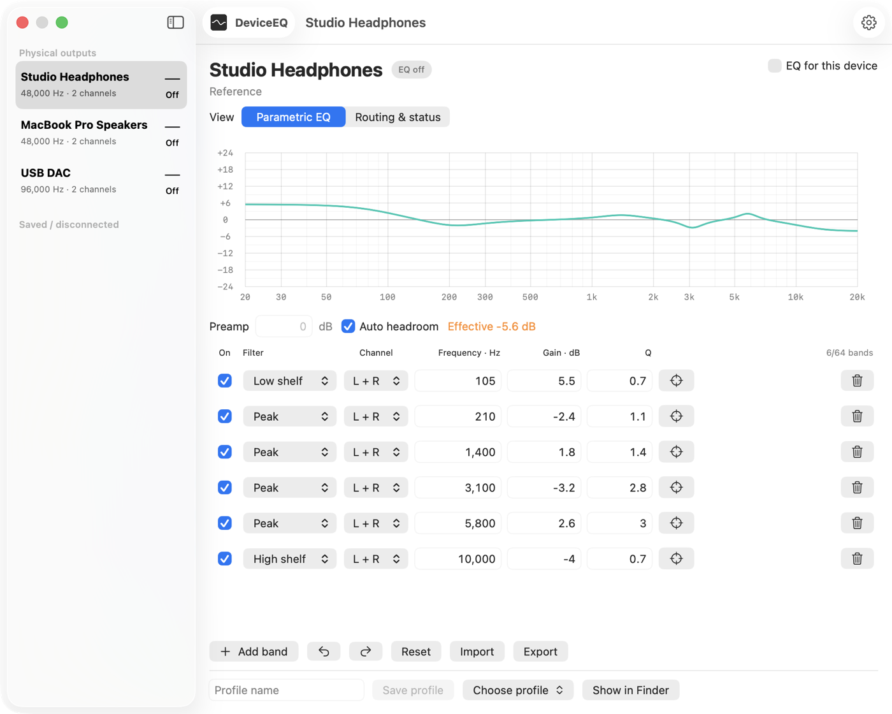
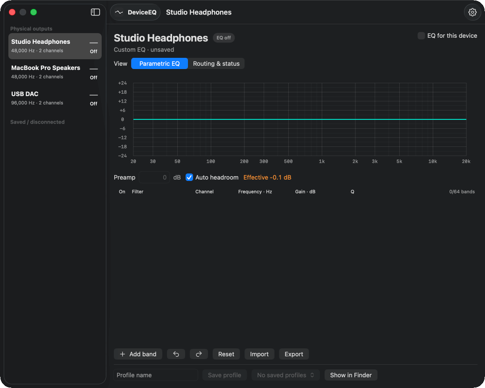

# DeviceEQ

<p align="center"></p>

<p align="center"><strong>A lightweight, free, open source parametric EQ for macOS. No audio driver required.</strong></p>

<p align="center">
<a href="https://github.com/Cat-in-a-Box-0115/DeviceEQ/actions"></a>
<a href="LICENSE"></a>

</p>

DeviceEQ gives each of your Mac's outputs its own parametric equalizer. Enable EQ for headphones, speakers, AirPods or a USB DAC and each keeps its own settings, while normal macOS output selection and native volume keys keep working. Outputs with EQ off play untouched. It uses Apple's Core Audio process taps, so there is no virtual audio device or driver to install.

## Highlights

- Per-device profiles that follow each output and survive disconnects
- Up to 64 bands: peak, low/high shelf, high/low pass and notch, stereo or per channel
- Import Squiglink, AutoEq and Equalizer APO parametric presets; export back to APO text
- Auto headroom, undo/redo, named presets and a live response graph
- Small (about 2 MB), no telemetry, no account, no network access

**Requirements:** Apple Silicon Mac, macOS 14.2 or later. This is an early release; see [VERIFICATION.md](VERIFICATION.md) for what has been tested and the known limits.

## Screenshots

<picture>
  <source media="(prefers-color-scheme: dark)" srcset="docs/screenshots/editor-dark.png">
  
</picture>

<details><summary>Animated demo</summary>



</details>

<sub>Demo data. The status badge reads "EQ off" because screenshots are rendered without a live audio route.</sub>

## Install

1. Download `DeviceEQ-<version>-local.zip` from [Releases](../../releases) and unzip it.
2. Move **DeviceEQ.app** to Applications.
3. The app isn't notarized by Apple, so macOS blocks the first launch. Open it once, click **Done**, then go to **System Settings → Privacy & Security**, scroll down and click **Open Anyway** next to DeviceEQ. (On macOS 14, right-click the app and choose **Open** instead.)
4. Grant system-audio permission when macOS asks. It is only used to process outputs you enable.

## Quick start

1. Select an output in the sidebar.
2. Add bands, or **Import** a Squiglink / AutoEq / Equalizer APO parametric `.txt`.
3. Turn on **EQ for this device**, and pick that output in macOS Sound as usual.

More in the [usage guide](docs/USAGE.md).

## Build from source

Install Apple's Command Line Tools (`xcode-select --install`), then:

```sh
./build.sh          # builds build.noindex/DeviceEQ.app
./Tests/verify.sh   # DSP, parser and model tests, no live audio
./install.sh        # quit any running copy first
```

There are no package downloads or Python dependencies. Local builds are ad-hoc signed, so macOS may ask for audio permission again after a rebuild. See [RELEASING.md](RELEASING.md) for packaging and signing.

## Audio quality notes

- Float32 I/O with double-precision filters; no added resampling, spatialization or normalization.
- EQ changes phase as well as amplitude. Auto headroom reduces clipping risk but a flat enabled profile is not bit-perfect, and no hard limiter is added.
- Not yet qualified: Bluetooth call/microphone mode, HDMI and multichannel outputs. Fixed-volume hardware stays fixed-volume.

## Privacy and removal

Audio is processed locally with no telemetry or accounts ([PRIVACY.md](PRIVACY.md)). Quit and run `./uninstall.sh` to move the app to Trash; profiles stay in `~/Library/Application Support/DeviceEQ`. No driver is installed.

## Project

[Roadmap](ROADMAP.md) · [Contributing](CONTRIBUTING.md) · [Security](SECURITY.md) · [Changelog](CHANGELOG.md) · [Architecture](ARCHITECTURE.md) · [Attribution](THIRD_PARTY_NOTICES.md) · [MIT license](LICENSE)

Vibe coded by **Cat-in-a-Box**.
